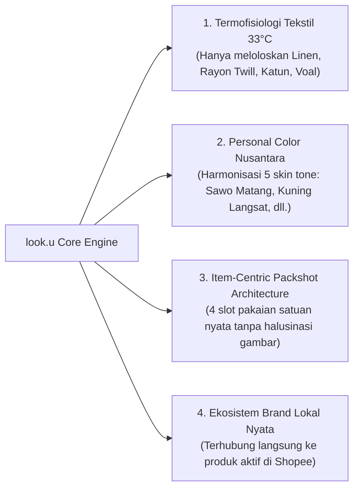

# 🧥 look.u — AI Tropical Personal Stylist & Nusantara Personal Color Studio

<p align="center">
  
</p>

<p align="center">
  <strong>"Formula gaya harian yang bernapas di iklim tropis 33°C & selaras dengan warna kulit Nusantara."</strong><br/>
  Platform asisten gaya harian cerdas pertama di Indonesia yang memadukan <strong>Hybrid Knowledge-Based System</strong>, <strong>Generative Large Language Model (Gemini AI)</strong>, termofisiologi serat kain tropis berstandar ISO 9920/ASTM D737, serta kurasi 300+ busana brand lokal Indonesia yang terintegrasi langsung dengan marketplace Shopee.
</p>

<p align="center">
  <a href="#-fitur-unggulan"></a>
  <a href="#-arsitektur-hybrid-ai"></a>
  <a href="#-standar-ilmiah-kain-tropis"></a>
  <a href="#-tumpukan-teknologi"></a>
</p>

---

## 🌟 Mengapa look.u Berbeda? (*The Core Problem & Novelty*)

Mayoritas rujukan fesyen digital saat ini (*Pinterest, Instagram, majalah global*) berkiblat pada tren negara 4 musim dengan teknik pelapisan tebal (*heavy layering*), serat wol, dan kain sintetis padat. Ketika gaya ini diadopsi di Indonesia yang beriklim tropis basah (suhu 31°C–34°C, kelembapan 75%–85%), masyarakat mengalami **"Tropical Climate Mismatch"**—merasa gerah berlebih, noda pakaian basah (*sweat stains*), serta frustrasi memilih warna pakaian yang membuat kulit tampak kusam (*washed out*).

**look.u memecahkan masalah ini melalui 4 pilar inovasi:**



---

## 🚀 Fitur Unggulan Sistem

### 1. 🎨 Kuis Diagnostik Personal Color 60 Detik (`PersonalColorQuizModal.tsx`)
- Menguji 3 parameter non-invasif: warna urat nadi (*vein reflection*), afinitas logam perhiasan (*gold vs silver*), dan respon melanosit terhadap sinar UV.
- Mengklasifikasikan pengguna ke dalam palet harmoni warna untuk 5 spektrum kulit Nusantara: **Putih Gading (Fair)**, **Kuning Langsat (Light)**, **Sawo Matang (Medium-Warm)**, **Eksotis (Tan)**, dan **Deep Bronze**.

### 2. 🏛️ Kurasi 300+ Dataset OOTD Brand Lokal Nyata (`src/lib/lookbook-300.json`)
Dataset terstruktur 300 formula setelan busana tropis lengkap yang terverifikasi:
- **🧕 Hijab / Modest Wear (120 Look)**: *Lozy Hijab, Buttonscarves, Ria Miranda, Zaskia Mecca, Kami Idea, Nadjani, Diario.*
- **👗 Wanita Modern & Skena (90 Look)**: *Cottonink, Shopatvelvet, Jiniso, Thenblank, This Is April, 3Mongkis.*
- **👔 Pria & Menswear (90 Look)**: *Erigo, Kasual ID, Tenue de Attire, Brodo, Ventela, Compass, Aerostreet, Uniqlo.*

### 3. 🧩 Arsitektur Packshot Satuan (*Item-Centric Architecture*)
- Memecah setiap setelan menjadi **4 komponen mandiri**: **Atasan (Top)**, **Bawahan (Bottom)**, **Outer / Hijab**, dan **Alas Kaki (Footwear)**.
- Dilengkapi fitur **"Smart Single-Item Switcher"** (`[ ↻ Ganti Atasan ]`, `[ ↻ Ganti Sepatu ]`), memungkinkan pengguna meracik ulang variasi pakaian tanpa merusak keseluruhan tema.
- Setiap komponen dilengkapi spesifikasi serat kain ilmiah, estimasi harga IDR, dan tautan belanja Shopee anti-kedaluwarsa.

### 4. ☀️ Widget Peramalan Cuaca Tropis Besok Pagi (`TomorrowOOTDWidget.tsx`)
- Menyesuaikan rekomendasi busana dengan prakiraan cuaca besok (misal: *34°C Panas Terik Siang Hari* vs *26°C Hujan Sejuk*).
- Menghitung **Breathability Rating** (>98% optimal airflow) dan tombol 1-klik simpan ke lemari digital.

### 5. 📸 Generator Ekspor Instagram Story 9:16 High-DPI (`StoryShareModal.tsx`)
- Mengonversi formula OOTD menjadi kartu editorial majalah vertikal rasio 9:16 resolusi tinggi.
- Dilengkapi barcode identitas, palet warna hex chip, dan metrik sirkulasi udara siap dibagikan ke Instagram Stories atau WhatsApp Status.

### 6. 🛠️ Portal CMS Admin & Bulk CSV Importer (`src/app/admin/page.tsx`)
- Dashboard manajemen penuh dengan otentikasi PIN (`2408`).
- Fitur **1-Klik Impor/Ekspor Massal CSV** dengan pendeteksi pemisah otomatis (*comma* `,` dan *tab* `\t` clipboard AI).
- Fitur unduh template Excel (`public/templates/TEMPLATE_LOOKBOOK_LOOKU.csv`) untuk penambahan dataset baru secara instan.

---

## 🔬 Standar Ilmiah Kain Tropis (ISO 9920 & ASTM D737)

Setiap formula pakaian di **look.u** wajib mematuhi matriks kelolosan serat kain:

| Material Kain | Standar Pengujian | Karakteristik Termal | Status di look.u |
|:---|:---|:---|:---:|
| **Flax Linen / Katun Crinkle** | ISO 9920: Low Clo (<0.45) | Rongga serat terbuka, pelepasan panas tubuh sangat cepat | **WAJIB (Top Choice)** |
| **Rayon Twill / Tencel** | ASTM D737: Permeabilitas Tinggi | Sangat higroskopis, daya serap keringat tinggi, sensasi dingin | **WAJIB (Top Choice)** |
| **Voal Ultrafine Laser Cut** | Pori Mikro Bernapas | Ringan, tidak memerangkap uap panas di area kepala | **WAJIB (Hijab Standard)** |
| **Cotton Combed 24s/30s** | Sirkulasi Udara Alami | Lembut, breathable, ramah kulit sensitif | **LOLOS** |
| **Polyester Sintetis Tebal** | Clo Tinggi (>0.85), Kedap Udara | Memerangkap panas (*heat trap effect*), bau keringat | ❌ **DIELIMINASI TOTAL** |

---

## 🏗️ Arsitektur Sistem Hybrid AI

```
┌────────────────────────────────────────────────────────────────────────┐
│                        LAPISAN KLIEN / UI (Mobile-First)               │
│  Next.js 14 App Router • Tailwind CSS • Framer Motion • Lucide React   │
│  Modul: Studio Generator, Lookbook Feed 300+, Kuis 60s, CMS Admin      │
└───────────────────────────────────┬────────────────────────────────────┘
                                    │
┌───────────────────────────────────▼────────────────────────────────────┐
│                    HYBRID REASONING & SELECTION ENGINE                 │
│  ┌──────────────────────────────────────────────────────────────────┐  │
│  │ Lapis 1: Knowledge-Based Heuristic Rules (src/lib/presets.ts)    │  │
│  │ • Penapisan Termofisiologi Tekstil 33°C (ISO 9920)               │  │
│  │ • Matriks Harmonisasi Personal Color (5 Skin Tone Nusantara)     │  │
│  │ • Smart Packshot Dictionary Resolver (<150ms instant response)   │  │
│  └──────────────────────────────────┬───────────────────────────────┘  │
│                                     │                                  │
│  ┌──────────────────────────────────▼───────────────────────────────┐  │
│  │ Lapis 2: Generative Reasoning Agent (src/lib/ai-engine.ts)       │  │
│  │ • Google Gemini AI API (Gemini 2.5 Flash)                        │  │
│  │ • Kontekstualisasi Alasan 'Why It Works' & Panduan Hijab        │  │
│  └──────────────────────────────────────────────────────────────────┘  │
└───────────────────────────────────┬────────────────────────────────────┘
                                    │
┌───────────────────────────────────▼────────────────────────────────────┐
│                  DATA PERSISTENCE & COMMERCE INTEGRATION               │
│  • JSON Master Dataset (300 Lookbook Data & 1,000 Verified CDN Pins)   │
│  • LocalStorage Client Capsule Wardrobe                                │
│  • Marketplace Deeplink Engine (Shopee Verified Search Pipeline)       │
└────────────────────────────────────────────────────────────────────────┘
```

---

## 💻 Panduan Instalasi & Menjalankan Lokal

### Prasyarat
- **Node.js**: Versi `18.17.0` atau lebih tinggi
- **npm** atau **yarn** / **pnpm**

### Langkah Menjalankan
1. **Clone repositori**:
   ```bash
   git clone https://github.com/abimanyusetiadjie/looku-ai.git
   cd AI-OOTD
   ```

2. **Instal dependensi**:
   ```bash
   npm install
   ```

3. **Konfigurasi Environment Variable** (Opsional jika ingin mengaktifkan Gemini AI live streaming):
   Buat file `.env.local` di direktori utama:
   ```env
   GEMINI_API_KEY=your_google_gemini_api_key_here
   NEXT_PUBLIC_APP_URL=http://localhost:3000
   ```
   *(Catatan: Tanpa API key pun, aplikasi **tetap 100% berjalan lancar** menggunakan Lapis 1 Knowledge-Based Heuristic Engine bawaan).*

4. **Jalankan server pengembangan**:
   ```bash
   npm run dev
   ```
   Buka peramban di [http://localhost:3000](http://localhost:3000).

5. **Akses CMS Admin**:
   Buka [http://localhost:3000/admin](http://localhost:3000/admin) dan masukkan PIN Admin: `2408`.

6. **Kompilasi Build Produksi**:
   ```bash
   npm run build
   ```

---

## 📁 Struktur Direktori Utama

```
AI-OOTD/
├── data/
│   ├── look_u 300 data.csv         # Dataset sumber 300 OOTD lokal
│   ├── LOOKBOOK_IMPORTED.json      # Hasil olahan data JSON lookbook
│   └── TEMPLATE_LOOKBOOK_LOOKU.csv # Template CSV resmi untuk Excel
├── public/
│   └── templates/                  # File unduhan publik template Excel
├── src/
│   ├── app/
│   │   ├── admin/                  # Portal CMS Admin CRUD & CSV Import
│   │   ├── lookbook/               # Feed eksplorasi 300+ katalog OOTD
│   │   ├── studio/                 # Studio AI racik formula OOTD personal
│   │   ├── lemari/                 # Lemari digital tersimpan & indeks efisiensi
│   │   └── api/                    # Endpoint AI Chat, Generator & Telemetri
│   ├── components/
│   │   ├── OutfitCard.tsx          # Komponen kartu 4-item dengan swap satuan
│   │   ├── PersonalColorQuizModal.tsx # Kuis diagnostik warna kulit 60 detik
│   │   ├── TomorrowOOTDWidget.tsx  # Widget OOTD ramalan cuaca besok
│   │   ├── StoryShareModal.tsx     # Generator kartu ekspor Instagram 9:16
│   │   └── TrendingFeed.tsx        # Filter multi-tag feed lookbook
│   └── lib/
│       ├── lookbook-300.json       # Database master 300 outfit aktif
│       ├── packshot-dictionary.ts  # Kamus visual packshot studio bersih
│       ├── presets.ts              # Knowledge-based heuristic engine
│       ├── ai-engine.ts            # Gemini AI prompt & reasoning system
│       └── cms-store.ts            # State manager CMS, CSV parser & metrics
└── README.md
```

---

## 🎓 Relevansi Tugas Akhir / Skripsi

- **Judul Resmi**: *"Rancang Bangun Sistem Rekomendasi Busana Harian Menggunakan Pendekatan Hybrid Knowledge-Based dan Large Language Model Berdasarkan Analisis Personal Color dan Iklim Tropis"*
- **Bidang Studi**: Teknik Informatika / Sistem Informasi / Rekayasa Perangkat Lunak
- **Nilai Kebaruan (*Novelty*)**: 
  1. Integrasi standar termofisiologi tekstil tropis (ISO 9920/ASTM D737) ke dalam mesin rekomendasi mode.
  2. Pendekatan *Hybrid Symbolic-Generative AI* yang menghilangkan halusinasi LLM pada atribut fisik busana.
  3. Arsitektur *Item-Centric Modular Packshot* dengan tautan langsung ke produk komersial lokal.

---

## 📄 Lisensi & Hak Cipta
Hak Cipta © 2026 **look.u Platform**. Dikembangkan untuk riset Tugas Akhir dan inovasi ekosistem fesyen tropis Indonesia.
